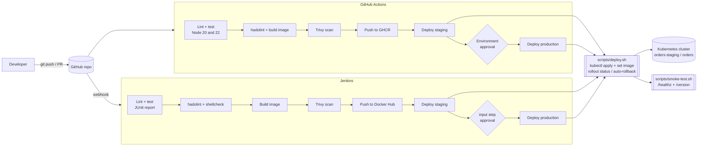

# CI/CD Pipeline with GitHub Actions and Jenkins

A Node.js **Orders API** shipped through two equivalent production-style CI/CD pipelines: a **GitHub Actions** workflow and a **Jenkins** declarative pipeline. Both lint and test the code, build a Docker image, scan it with Trivy, push it to a registry, deploy it to a Kubernetes staging namespace, and promote it to production behind a manual approval.

Both pipelines call the same `scripts/deploy.sh` and `scripts/smoke-test.sh`, so the deploy logic lives in one place and the CI tool is interchangeable.

> **Status:** GitHub Actions is disabled on this repository and nothing has been deployed. The deploy stages are fully defined and run once cluster credentials are configured (see below).

## Architecture



## How it works

| Stage | GitHub Actions (`.github/workflows/ci-cd.yml`) | Jenkins (`Jenkinsfile`) |
|-------|-----------------------------------------------|-------------------------|
| Trigger | push to `main`, tags `v*`, PRs, manual | multibranch scan or GitHub webhook |
| Lint and test | ESLint + `node --test` with coverage, matrix on Node 20 and 22, ShellCheck | ESLint + `node --test` in a `node:20-alpine` agent, JUnit report published |
| Dockerfile lint | `hadolint-action` | `hadolint` container (parallel with ShellCheck) |
| Build | Buildx with GHA layer cache, tags `sha-<short>`, branch, semver | `docker build`, tag `sha-<short>` |
| Scan | Trivy, fails on fixable HIGH/CRITICAL | Trivy, same policy |
| Push | GHCR via `GITHUB_TOKEN` (skipped on PRs) | Docker Hub via `dockerhub-creds` (main only) |
| Staging | `staging` environment, kubeconfig from secret | `kubeconfig-staging` secret file |
| Approval | required reviewers on the `production` environment | `input` step with a one-hour timeout |
| Production | `production` environment | `kubeconfig-production` secret file |

Deployments pin the immutable `sha-<short>` tag, wait for `kubectl rollout status`, and run `kubectl rollout undo` automatically if the rollout fails. The smoke test then confirms `/healthz` and that `/version` reports the commit that was built.

### The application

`src/` is a small Express REST API for orders, with input validation and price, discount and 18% GST calculation.

| Method | Path | Purpose |
|--------|------|---------|
| GET | `/healthz` | liveness |
| GET | `/readyz` | readiness |
| GET | `/version` | build version (`APP_VERSION`, set to the commit SHA at build time) |
| GET | `/api/orders` | list orders |
| GET | `/api/orders/:id` | get one order |
| POST | `/api/orders` | create an order `{ customer, items: [{ sku, quantity, unitPrice }], discountPercent? }` |
| PATCH | `/api/orders/:id/status` | set status to `CREATED`, `PAID`, `SHIPPED` or `CANCELLED` |

Storage is in-memory so the pipeline is the focus; swap `src/store.js` for a database adapter in a real service.

## Repository layout

```
.
├── .github/workflows/ci-cd.yml   # GitHub Actions pipeline
├── Jenkinsfile                   # Jenkins declarative pipeline
├── Dockerfile                    # multi-stage, non-root, healthcheck
├── src/                          # Express API
├── tests/                        # node:test unit + HTTP tests
├── deploy/k8s/                   # Deployment (probes, limits, hardened securityContext) + Service
├── scripts/deploy.sh             # shared deploy with auto-rollback
├── scripts/smoke-test.sh         # shared post-deploy check
├── jenkins/                      # local Jenkins controller (Dockerfile, compose, plugins)
└── docs/jenkins-setup.md         # credentials and job setup
```

## Run it locally

Prerequisites: Node.js 20+, Docker, and optionally `kubectl` with [kind](https://kind.sigs.k8s.io/).

1. Install dependencies, lint and test:
   ```bash
   npm ci
   npm run lint
   npm test
   ```
2. Run the API:
   ```bash
   npm start
   curl -s localhost:3000/healthz
   curl -s -X POST localhost:3000/api/orders \
     -H 'content-type: application/json' \
     -d '{"customer":"Acme","items":[{"sku":"BOOK-1","quantity":2,"unitPrice":499}]}'
   ```
3. Build and run the container:
   ```bash
   docker build --build-arg APP_VERSION=local -t orders-api:local .
   docker run --rm -p 3000:3000 orders-api:local
   scripts/smoke-test.sh http://localhost:3000 local
   ```
4. Deploy to a local kind cluster with the same script the pipelines use:
   ```bash
   kind create cluster --name orders
   kind load docker-image orders-api:local --name orders
   scripts/deploy.sh orders-api:local orders-staging
   kubectl -n orders-staging port-forward svc/orders-api 8081:80 &
   scripts/smoke-test.sh http://localhost:8081 local
   ```
   `DRY_RUN=1 scripts/deploy.sh orders-api:local` validates the manifests without touching a cluster.

## Turn on the GitHub Actions pipeline

1. **Settings → Actions → General**: allow actions for this repository (it is currently disabled).
2. **Settings → Environments**: create `staging` and `production`. On `production`, add yourself as a required reviewer.
3. Add environment secrets, each a base64-encoded kubeconfig (`base64 -w0 ~/.kube/config`):
   - `staging`: `KUBECONFIG_STAGING`
   - `production`: `KUBECONFIG_PRODUCTION`
4. Add environment variables `STAGING_URL` and `PRODUCTION_URL` (the public URLs the smoke test should hit).
5. Push to `main`. The image lands in `ghcr.io/shubhamkhedkar/orders-api`. If the cluster pulls from a private GHCR package, add an `imagePullSecret` or make the package public.

## Turn on the Jenkins pipeline

Follow [docs/jenkins-setup.md](docs/jenkins-setup.md): start the controller, add the three credentials, and create a Multibranch Pipeline pointing at this repository.

## Cleanup

```bash
# Kubernetes workloads
kubectl delete namespace orders-staging orders --ignore-not-found
kind delete cluster --name orders

# Local images
docker rmi orders-api:local

# Local Jenkins
cd jenkins && docker compose down -v

# Registry images: delete the orders-api package under GitHub → Packages,
# and the shubhamkhedkar/orders-api repository on Docker Hub.
```

Also remove the kubeconfig secrets from the GitHub environments and the Jenkins credentials store when you no longer need them.

## License

MIT
